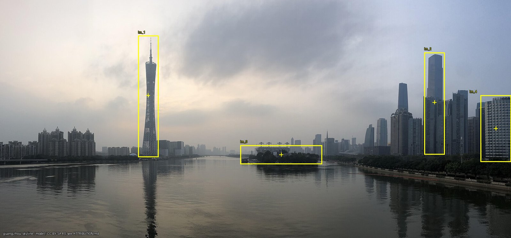
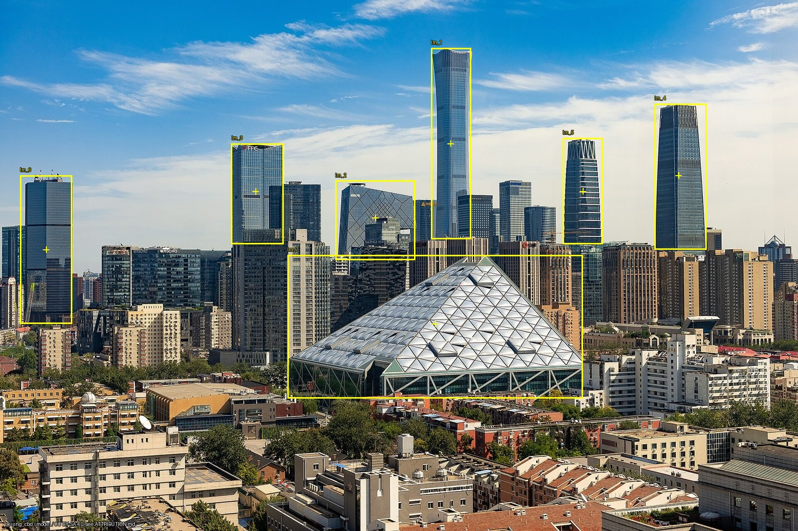
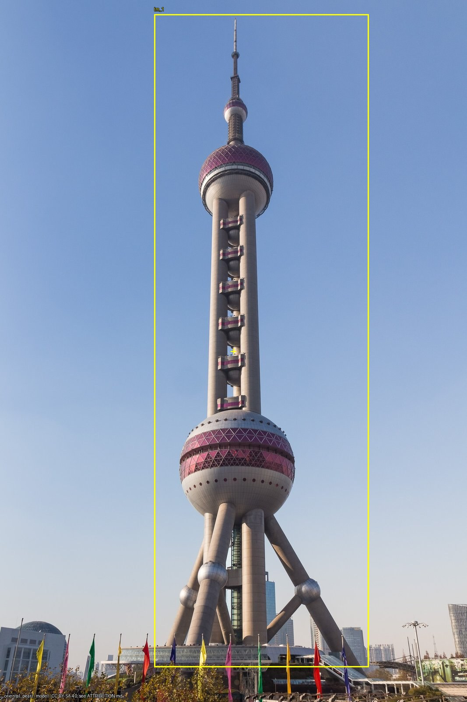

# Stage 2.1：真实旅游照片识别验证

执行日期：2026-11-14（Asia/Shanghai）。本次只验证现有 Stage 2 的真实图片行为，不开发 Stage 3，不修改 Stage 1 几何算法。

## 照片、许可与独立参考答案

获取 3 张真实照片，均为 Wikimedia Commons 的 CC BY-SA 4.0 作品。保存的是 Commons 提供的 1920 像素宽、未裁剪缩略图，3 张输入合计约 1.75 MiB，完整署名、许可链接、修改说明见 [ATTRIBUTION.md](evaluation/stage2_1/ATTRIBUTION.md)，下载地址、来源说明、尺寸、SHA-256 见 [sources.json](evaluation/stage2_1/sources.json)。

| 样本 | 照片来源及作者 | 输入尺寸 | 预先核对的目标地标 |
| --- | --- | --- | --- |
| 广州天际线 | [GuangzhouSkyline2020.jpg](https://commons.wikimedia.org/wiki/File:GuangzhouSkyline2020.jpg)，Josephua | 1920×895 | 广州塔、广州国际金融中心（西塔）、广州周大福金融中心（东塔） |
| 北京 CBD | [Parkview Green and CBD skyline (20210927131419).jpg](https://commons.wikimedia.org/wiki/File:Parkview_Green_and_CBD_skyline_(20210927131419).jpg)，N509FZ | 1920×1280 | 中国尊、中央电视台总部大楼、侨福芳草地 |
| 东方明珠近景 | [Oriental Pearl Tower in Shanghai.jpg](https://commons.wikimedia.org/wiki/File:Oriental_Pearl_Tower_in_Shanghai.jpg)，Dmitry A. Mottl | 1920×2880 | 东方明珠广播电视塔 |

身份参考来自照片说明、同一原图的独立命名裁剪及建筑参考图库，再直接目视核对照片形状；没有使用本项目模型的预测建立答案。广州双塔以 [IFC 左、CTF 右的独立摄影说明](https://commons.wikimedia.org/wiki/File:Guangzhou_Two_Towers_b_02-10-2018.jpg)及各建筑图库辅助辨认；中国尊由[同一北京原图的独立裁剪说明](https://commons.wikimedia.org/wiki/File:Parkview_Green_and_CBD_skyline_(20210927131419)_2_1_1_1.jpg)确认；央视总部依据[建筑参考图库](https://commons.wikimedia.org/wiki/Category:CCTV_Headquarters_(2010))及独特折叠环形外观辨认。侨福芳草地由原图文件名和 depicts 元数据确认，东方明珠由来源名称与球体、塔柱、斜撑外观确认。

模型调用前已固定 [ground_truth.json](evaluation/stage2_1/ground_truth.json)，包含 7 个目标、人工近似可见边界框和 8 条非重复参考关系。每次发送 HTTP 请求前把该文件 SHA-256 和输入图片 SHA-256 写入 [requests.json](evaluation/stage2_1/requests.json)，用于核对参考答案没有随结果修改。

人工关系采用图像中心的左右、上下语义，与 Stage 2 接口一致：广州塔在西塔左侧、西塔在东塔左侧；北京央视总部在中国尊及芳草地左侧，中国尊在央视及芳草地上方，央视在芳草地上方。北京中国尊与芳草地的横向中心接近，不设确定左右关系。广州远景建筑被遮挡，垂直关系不纳入评分；东方明珠单目标样本不进行跨地标关系评分。反向关系不重复计分。

## 执行路径与计数规则

使用已有 `.env` 的 `qwen3.8-flash` 和百炼兼容地址，实际调用项目 `VisionAnalyzer.analyze_prepared(prepare_image(path))`。不改变提示词，不向模型提供城市名、文件名、来源、参考身份或参考框；模型只看到预处理后的 JPEG 及现有通用提示词/schema。没有读取 EXIF GPS 辅助识别。

评估脚本禁用 SDK 自动重试，每次真实 HTTP 请求单独记账，总额度为 5。最初按 `.env` 的 60 秒超时执行；多地标照片超时后，通过仅当前命令进程的环境变量临时将单次超时增至 180 秒复测，不改写 `.env`。已成功且保存的图片不再请求。超时同样消耗额度，不能从记录中删除或计为成功。

真实执行命令（第二条为仅复测尚无结果的图片）：

```powershell
uv run python scripts/evaluate_real_images.py --run-api
$env:GEOPHOTOLOC_VLM_TIMEOUT = '180'
uv run python scripts/evaluate_real_images.py --run-api
```

纯离线重绘/比较命令，不会产生 API 调用：

```powershell
uv run python scripts/evaluate_real_images.py
uv run python scripts/compare_real_images.py
uv run pytest
```

完整识别结果保存在 `evaluation/stage2_1/results/`，不人工改写模型地标或关系。`annotations/*_reference.jpg` 为绿色人工参考框，`annotations/*_model.jpg` 为黄色模型框、中心与 ID；均绘制在应用实际处理后的尺寸上。人工框是可见部分的近似矩形，遮挡部分不向下臆测；IoU 和归一化中心误差只作为本次核验诊断，不是像素级专业标注的精度声明。

## 实际 API 记录

共 **5 次真实 HTTP 请求：3 次成功、2 次超时，SDK 自动重试 0 次**，没有切换模型。时间按请求账本 UTC 换算为 Asia/Shanghai；超时前服务端是否已生成或计费无法从客户端确认。

| 次数 | 样本 | 本地开始时间 | 单次超时 | 结果 | 耗时约 |
| --- | --- | --- | --- | --- | --- |
| 1 | 广州 | 2026-11-14 00:38:25 | 60 秒 | 超时，没有可验证完整结果 | 60 秒 |
| 2 | 北京 | 2026-11-14 00:39:26 | 60 秒 | 超时，没有可验证完整结果 | 60 秒 |
| 3 | 东方明珠 | 2026-11-14 00:40:26 | 60 秒 | 成功，1 个对象、0 条关系 | 7 秒 |
| 4 | 广州复测 | 2026-11-14 00:40:57 | 180 秒 | 成功，4 个对象、22 条有向关系 | 43 秒 |
| 5 | 北京复测 | 2026-11-14 00:41:41 | 180 秒 | 成功，7 个对象、76 条有向关系 | 27 秒 |

复测实际耗时短于 60 秒，不能据此认定“只要增大超时就能解决”或断言模型持续需要超过 60 秒；本次观察到调用延迟存在波动。请求前后脚本检查 `.env` 内容一致，未提交该文件或 API Key。没有再发送第 6 次请求。

## 每张照片的识别与几何核验

### 广州天际线

完整结果：[guangzhou_skyline.json](evaluation/stage2_1/results/guangzhou_skyline.json)。处理尺寸 1600×746，保留完整视野。

- `lm_1` 明确命名 `Canton Tower`，身份与位置正确。
- `lm_2` 为 `Tall rectangular skyscraper`。框覆盖真实东塔，候选同时给出 `Guangzhou CTF Finance Centre` 和 `Guangzhou International Finance Center`，属于身份混淆/未消歧，不能计作同时认出了东西两塔。
- 真实西塔位于东塔左侧，照片中可见，但没有对应的独立模型对象，计为漏检。
- `lm_3` 通用描述为带体育设施的河中岛，候选 `Haixinsha Island` 未纳入固定身份评分；`lm_4` 是最右侧带 CCB 标志的建筑，通用描述与位置合理，不强行赋予具体名称。
- 广州塔与东塔的 `LEFT_OF`、反向 `RIGHT_OF` 均正确；另外两条涉及漏检西塔的参考关系无法核验，不能记为正确。
- `lm_3` 的框上边为 y=0.61，主要覆盖树冠和岸线；如果对象定义包括依据中提到的高桅杆/体育设施，上方结构未完整入框，存在框选范围偏小的案例。其余已定位目标未见整栋建筑错位。



人工参考：[绿色参考框](evaluation/stage2_1/annotations/guangzhou_skyline_reference.jpg)。

### 北京 CBD

完整结果：[beijing_cbd.json](evaluation/stage2_1/results/beijing_cbd.json)。处理尺寸 1600×1067。

- `lm_1` 用 `Flared-top glass skyscraper` 描述中国尊，候选 `CITIC Tower (China Zun)` 正确，但 `identity_uncertain=true`，保留为未确认身份。
- `lm_2` 用 `Cantilevered loop tower` 描述央视总部，候选 `CCTV Headquarters` 正确，同样明确不确定。其框覆盖正确建筑；中心落在包围矩形内，但因遮挡/环形建筑结构，中心像素可能在前景遮挡物上，不能当作可见建筑表面的精确特征点。
- `lm_7` 的 `Glass pyramid roof structure` 框覆盖真实侨福芳草地，未给出名称候选，属于检测成功、身份未识别。
- `lm_3`（FFC 标志）、`lm_4`（右侧渐缩塔楼）、`lm_5`（冠状格构塔楼）、`lm_6`（左侧深色塔楼）均与可见建筑大致对应；这些额外对象未建立独立名称标准，不把候选 Fortune Financial Center 或其他推测计入身份正确数。
- 三个固定目标之间的 5 条参考关系全部正确：央视在中国尊及芳草地左侧，中国尊在央视及芳草地上方，央视在芳草地上方。中国尊与芳草地 x 差 0.020，不输出确定左右关系，符合默认 0.03 阈值。



人工参考：[绿色参考框](evaluation/stage2_1/annotations/beijing_cbd_reference.jpg)。

### 东方明珠近景

完整结果：[oriental_pearl.json](evaluation/stage2_1/results/oriental_pearl.json)。处理尺寸 1067×1600。

`lm_1` 明确命名 `Oriental Pearl Tower`，球体、塔柱、天线和斜撑等识别依据与实物一致。框覆盖主要塔体，没有明显整体偏移。报告中心 (0.500,0.500) 在塔柱附近，但不等于模型框中心 (0.560,0.485)，说明模型中心值是近似观测；不能假定与矩形中心严格一致。只有一个目标，返回空空间关系列表合理。



人工参考：[绿色参考框](evaluation/stage2_1/annotations/oriental_pearl_reference.jpg)。

## 定量诊断与样本统计

以原照片和预先固定的参考框进行人工物体对应，记录于 [manual_review.json](evaluation/stage2_1/manual_review.json)。人工对应只说明模型框画的是哪座建筑，不会把通用描述或不确定候选改成模型已确认名称。离线比较结果：[comparison.json](evaluation/stage2_1/comparison.json)。

下表框顺序为 `(x_min,y_min,x_max,y_max)`，中心误差为到人工参考矩形中心的归一化二维欧氏距离，非米制距离。所有坐标对应处理后完整图片；参考框为近似值。

| 真实目标 | 模型 ID | 身份结果 | 中心 (x,y) | 模型框 | 与参考框 IoU | 中心误差 |
| --- | --- | --- | --- | --- | --- | --- |
| 广州塔 | lm_1 | 主名称正确 | (0.290,0.400) | (0.270,0.150,0.310,0.660) | 0.8347 | 0.0104 |
| 广州西塔 | — | 漏检；名字出现在另一栋建筑候选中不算命中 | — | — | — | — |
| 广州东塔 | lm_2 | 含正确候选，但与西塔混淆 | (0.850,0.430) | (0.830,0.220,0.870,0.650) | 0.7722 | 0.0136 |
| 中国尊 | lm_1 | 正确候选，未确认 | (0.565,0.270) | (0.540,0.090,0.590,0.450) | 0.9013 | 0.0049 |
| 央视总部 | lm_2 | 正确候选，未确认 | (0.470,0.410) | (0.420,0.340,0.520,0.490) | 0.8514 | 0.0039 |
| 侨福芳草地 | lm_7 | 只有通用描述 | (0.545,0.610) | (0.360,0.480,0.730,0.750) | 0.9775 | 0.0070 |
| 东方明珠 | lm_1 | 主名称正确 | (0.500,0.500) | (0.330,0.020,0.790,0.950) | 0.9609 | 0.0623 |

仅对这 **3 张照片、7 个预先指定的建筑目标**报告：

- 明确正确主名称 **2/7**；正确且仍不确定的单一身份候选 **2/7**；含正确身份但存在竞争候选 **1/7**；仅通用描述 **1/7**；目标漏检 **1/7**。候选不升级为已确认身份，未发现给固定目标明确命名为另一座建筑的案例。
- 物体对应及定位 **6/7**；对应的 6 个目标中心全部在人工参考框内、框 IoU 均大于 0.5。未检测的西塔不能以“没有错误框”算通过，也不能用别的建筑候选名单补齐。
- 8 条预先设定、反向不重复计分的参考关系中，**6 条正确、0 条反向错误、2 条因西塔漏检不可核验**。这 6 条在具备人工物体对应后可核验，不表示模型已经知道双方的地图实体身份。
- 模型共输出 12 个对象、98 条有向关系。98 条均通过严格 schema、引用与坐标方向校验；其中超出固定参考目标对的关系不纳入上述 6/8 语义核验结果。数值自洽不等于全部获得独立语义真值验证。
- 样本含 2 张多地标天际线、1 张单地标近景，没有夜景、恶劣天气或广泛视角覆盖。**不据此宣称普遍准确率或模型总体能力。** 模型自报 confidence 不作为经过校准的概率。

## 问题、回归测试与后续边界

成功案例：东方明珠和广州塔能够明确识别；中国尊、央视总部即使不确认身份，也能给出正确候选和合理框；已有坐标关系计算在可核验目标对上正确。

失败/限制：两次初始超时；西塔漏检；东塔候选混入西塔；芳草地身份未识别；岛屿对象包含设施时框可能不完整；模型中心与矩形中心不一定一致。未发现确定性的 JSON 解析、坐标单位/轴向、预处理缩放或关系计算 Bug，因此没有改写 Stage 2 业务逻辑或几何算法，也没有通过照片答案硬编码修正模型输出。

新增 5 项离线评估回归用例，验证“通用描述不算明确身份”“候选出现在错误物体上不补回漏检”“身份未确认时仍可独立核验图像几何”以及非法/重复人工对应被拒绝。开发中首次测试暴露了用通用词 Tower/Bridge 当作身份标准的测试夹具歧义，已改为独立具体名称 Alpha Tower/Beta Bridge，不修改真实照片参考答案。最终执行 `uv run pytest`：**185 passed，0 failed，0 skipped**，包含原 180 项测试与全部 Stage 1 回归测试。

后续 Stage 3 应保留候选集合与身份不确定性，避免把通用描述强制转换为唯一 OSM 实体，特别防止东西塔混淆、把其他物体上的候选名当作实际检测目标。后续 Stage 4 应允许漏检和未确认约束，区分视觉中心、可见范围与地图点位，避免把遮挡区域中心当作精确特征点；左右关系不等于地图东西，上下不代表南北或距离。只有左右顺序不能唯一确定机位。本阶段仅记录这些接口限制，未开发检索或机位求解。
